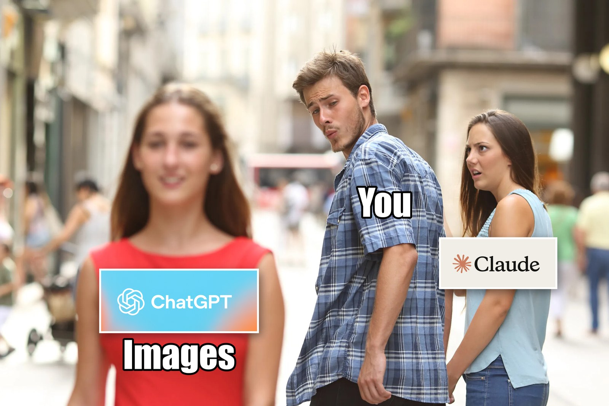

# chatgpt-images-for-claude



Do you love using Claude but wish it could generate ChatGPT quality images?

This is a Claude Code skill that makes images with ChatGPT's image model without leaving Claude
Code, and without an OpenAI API key.

Claude writes the prompt. The Codex CLI, signed in with your ChatGPT account, runs its built-in
`image_gen` tool. Claude reads the result and checks any on-image text letter by letter. A small
Pillow script then finishes the file to spec: exact pixel or print size, DPI, padding, fit,
background, upscale, and format (PNG, JPG, WebP, TIFF, PDF).

Nothing is generated until you approve it, and you never have to leave the chat. Like the
ChatGPT app, the reference images, the prompt and the finished image all show up right in the
conversation (in the Claude desktop app they open in the side panel). You reply "go", or type a
change in plain words. No browser page opens unless you choose one: for a batch of more than 4
images, Claude asks whether you want to review it in the chat or on an HTML page that shows
every prompt and result side by side.

## Why a finishing step

The image model picks its own pixel size (about 1.5 MP) and does not hold exact margins. So the
prompt asks only for aspect ratio and composition, and `finish_image.py` sets the exact size,
margins and format afterward. Ask for a letter-size PDF with 1.25 in margins and that is what
you get, every time.

## Requirements

- **Claude Code.**
- **Codex CLI signed in with ChatGPT.** Either the ChatGPT desktop app (which bundles Codex) or
  a standalone Codex CLI install. Image generation needs a paid plan (it is not available on
  the Free plan) and uses your plan's limits faster than ordinary Codex turns.
- **Python 3 with Pillow:** `python3 -m pip install Pillow`
- **macOS** is the tested platform. The scripts are plain bash and Python and should run on
  Linux, but that is untested.

The scripts find Codex in this order:

1. `$CODEX_BIN`
2. `codex` on your `PATH`
3. `/Applications/ChatGPT.app/Contents/Resources/codex-cli/bin/codex` (the copy inside the ChatGPT app on macOS)
4. `/Applications/ChatGPT.app/Contents/Resources/codex` (where older ChatGPT app versions kept it)

The skill also reads the `imagegen` system skill that ships with Codex, at
`${CODEX_HOME:-~/.codex}/skills/.system/imagegen/`.

## Install

Copy this folder into your Claude Code skills directory under the skill's name,
`chatgpt-imagegen` (the installed folder name must match the `name` in `SKILL.md`).

```bash
cp -R chatgpt-images-for-claude ~/.claude/skills/chatgpt-imagegen
```

For a single project, copy it to `<project>/.claude/skills/` instead.

Check that Codex is reachable and signed in:

```bash
codex login status
```

If `codex` is not on your `PATH` but the ChatGPT app is installed, use
`/Applications/ChatGPT.app/Contents/Resources/codex-cli/bin/codex login status`.

## Quick start

In Claude Code:

> Make a portrait 4:5 poster for a spring bake sale, headline "Spring Bake Sale", letter size
> PDF with 1 inch margins, save it in ./print

Claude will:

1. Ask for an output folder if you didn't give one. There is no default.
2. Show you the reference images and the prompt as a short table in the chat.
3. Wait. Type a change ("make the text white") and it re-posts only what changed, or say **go**.
4. Generate (about 1 to 2.5 minutes per image), check the text letter by letter, finish the
   files, show the finished image in the chat and report the paths.
5. If the image is the start frame for something else, such as an image-to-video model, write
   that prompt in a copyable block with a link to the tool, and reveal the file in Finder so you
   can drag it in.

Batches of more than 4 images: Claude asks whether to stay in the chat or open an HTML page.
The read-only page shows every prompt and reference, then turns into a live results page as images finish,
with a Copy path button on every file.

Output layout:

```
<your folder>/
  spring-bake-sale.pdf        finished files
  codex-raw/                  manifest, status, raw PNGs, prompts, Codex logs (and the preview page, if used)
```

Files are never overwritten; repeats get `-v2`, `-v3`.

## The scripts

They also work on their own.

| Script | What it does |
|---|---|
| `scripts/codex_generate.sh` | One image through `codex exec` and `image_gen`. |
| `scripts/finish_image.py` | Size, DPI, padding, fit, background, upscale, format. |
| `scripts/make_preview.py` | Read-only HTML preview of a manifest, offered for batches of more than 4 images; shows results once a batch runs. |
| `scripts/batch_generate.py` | Runs a manifest: 2 at a time by default (max 4), resumable, `--redo NAME`, `--dry-run`. |

Re-finish an existing image without generating a new one:

```bash
python3 scripts/finish_image.py raw.png --preset ig-feed --fit cover --out out/promo.jpg
```

All presets and flags: [references/output-options.md](references/output-options.md). The
manifest format is in the docstring of `scripts/batch_generate.py`.

## Limits

- One image per generation; variants are separate generations.
- Native output is about 1.5 MP. Anything larger is interpolated; the finisher warns when it
  enlarges more than 1.5x.
- Exact margins in the prompt are ignored by the model. Use `--trim` and `--padding`.
- Masks and other API-only controls are not available through `image_gen`. The paid API
  fallback in the Codex imagegen skill needs `OPENAI_API_KEY`; the skill never switches to it
  without asking you.
- ChatGPT plan image limits are not published. When ChatGPT says image generation is
  unavailable (usually the plan limit), a batch pauses on its own: it lets the running images
  finish, waits 5 minutes, and resumes (then 10 and 20 minutes if it is still refused). After
  3 pauses it stops; re-run the same command later and it picks up where it left off.

## Tested on

macOS, codex-cli 0.155.0-alpha, September 2026. Notes from testing, not guarantees:

- `image_gen` works under `codex exec` with the ChatGPT app closed.
- `-s workspace-write -C <dir>` is enough to write outside the home folder.
- About 1.5 MP native (e.g. 1122x1402 for 4:5); 55 to 150 seconds per image.
- Two parallel runs worked.
- The aspect ratio in the prompt is honored; exact margins are not.
- The model is GPT Image. Codex docs name gpt-image-2; the tool does not report the exact
  version.

## Tests

`tests/smoke.sh` runs offline smoke tests with a stub Codex CLI, so it generates nothing and
uses none of your plan:

```bash
bash tests/smoke.sh
```

## Terms, privacy and consent

- Not affiliated with or endorsed by OpenAI or Anthropic. ChatGPT, Codex and Claude are
  trademarks of their owners.
- You are responsible for following OpenAI's Terms of Use and your plan's limits. For
  unattended, scheduled or CI use, use an OpenAI API key instead of ChatGPT sign-in.
- Prompts and reference images are sent to OpenAI.
- Only use a person's likeness with their consent.

## License

MIT. See [LICENSE](LICENSE).
